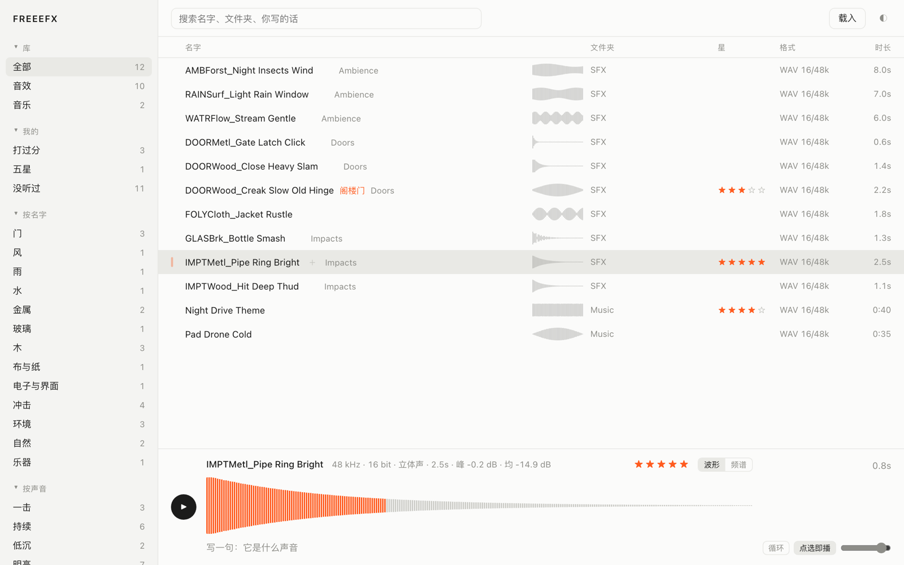

# FREEEFX

[中文](#中文) · [English](#english)



---

## 中文

FREEEFX 是一个给剪辑师和声音设计师用的本地音效／音乐库。把素材文件夹拖进来，它会自动分类、画波形；选好的声音可以整条或框选一段，直接拖进达芬奇、Pro Tools 或访达。

全程离线，不联网，不上传。它只读你拖进来或「载入」的文件夹，不会扫描磁盘上的其他位置。

### 能做什么

- **拖进来就整理**：拖入文件夹或散文件，左栏自动分出「音效／音乐」（以 30 秒为界）、文件夹树（任意深度），以及「我的」（打过分、五星、没听过、最近加入）。
- **自动分类**：
  - 按名字：门、风、雨、水、金属、玻璃、冲击、环境、人声……共 26 类，认中、英、日关键词。会读文件里的 BWF `bext`、iXML、LIST INFO 与标签，并把 UCS 的 CatID 拆开来认（`DOORWood` → 门、木）。
  - 按声音：一击、持续、低沉、明亮、很轻、可能削波，由分析音频得出。
- **试听**：点一行就播放，切换时带淡入淡出，不会有咔哒声。底栏显示波形和频谱（按 `S` 切换），点哪里就从哪里播。音量、循环、点选即播三项设置会被记住。
- **框选一段**：在波形上框出一段，可以试听、循环，导出为 24-bit WAV（首尾各做 5 ms 淡变）；也可以按住选段直接拖出去。拖出途中按 Esc，或松回本窗口，就算取消，不留下文件。
- **拖出到剪辑软件**：macOS 用原生 `NSDraggingSession`，Windows 用 OLE 拖放，行和选段都能拖进时间线。
- **打分、关键字**：可以给每条打 1–5 星；在名字后面写关键字，能被搜到，不会改动文件名。
- **搜索**：多个词取交集，范围是名字、文件夹和你写的关键字。
- **转格式**（右键菜单）：WAV 16/24、WAV 24/48k、AIFF 24、FLAC、ALAC、AAC 256k。新文件放进导出夹，遇到同名自动加编号，绝不覆盖原件。
- **删除只限副本**：只有导出夹里的副本能移到废纸篓／回收站，原件删不了。
- **够快**：两万条的库，带缓存重启约 0.5 秒，搜索每次按键 6–14 ms，滚动流畅。

支持的格式：WAV（PCM 8/16/24/32、float 32/64、Extensible、W64）、AIFF、FLAC、MP3、AAC/M4A、ALAC、OGG/Opus、CAF。

### 下载

到 [Releases](../../releases) 下载：

| 系统 | 文件 |
|---|---|
| macOS（Apple 芯片） | `FREEEFX-0.2.0-macOS-arm64.dmg` |
| Windows 10/11 x64 | `FREEEFX-0.2.0-windows-x64.zip`（解压后运行 `FREEEFX.exe`，`bin` 文件夹要和它放在一起） |

安装包没有经过苹果或微软的付费签名，第一次打开时系统会拦一下：

- **macOS**：在「应用程序」里右键 FREEEFX，选「打开」，再点「打开」。如果仍然打不开，在终端运行 `xattr -dr com.apple.quarantine /Applications/FREEEFX.app`。
- **Windows**：SmartScreen 弹窗里点「更多信息」，再点「仍要运行」。

### 从源码构建

需要 Go 1.27 及以上。界面框架是 [MyGo](https://github.com/egoist/mygo)，已作为 Go tool 写进 `go.mod`。

```sh
go test .
go tool mygo dev          # 开发版
./构建.sh                 # 出 dmg 与 Windows zip，产物放在上一级目录
```

FFmpeg 不放在仓库里，按需自己准备（缺了它也能用，只是右键没有「转成」，非 WAV/AIFF 文件不做分析）：

- macOS：把 [ffmpeg-8.1.tar.xz](https://ffmpeg.org/releases/ffmpeg-8.1.tar.xz) 放到 `third_party/ffmpeg/`，运行 `third_party/ffmpeg/编译-mac.sh`，会编出一个只含音频功能、LGPL 许可的 ffmpeg，放进 `resources/darwin-arm64/bin/`。
- Windows：从 [BtbN/FFmpeg-Builds](https://github.com/BtbN/FFmpeg-Builds/releases) 下载 `ffmpeg-master-latest-win64-lgpl`，把 `ffmpeg.exe` 放进 `resources/windows-amd64/bin/`。

### 数据放在哪

星级、关键字、库的位置存在系统的应用数据目录（macOS：`~/Library/Application Support/FREEEFX`），音频文件本身一个字节都不会改。

### 许可

FREEEFX 以 [MIT](LICENSE) 许可发布。随包的 FFmpeg 以独立程序方式调用，许可为 LGPL，详见 [resources/ffmpeg-NOTICE.txt](resources/ffmpeg-NOTICE.txt)。

---

## English

FREEEFX is a local sound-effects and music library for editors and sound designers. Drop your sample folders in and it sorts and draws waveforms for them. Drag a whole file, or a selected region of it, straight into DaVinci Resolve, Pro Tools or Finder.

Fully offline: no network, no uploads. It only reads the folders you drop in or load. It never scans the rest of your disk.

### Features

- **Drop to organize**: drop folders or loose files. The sidebar fills in by itself: SFX / Music (split at 30 s), a folder tree of any depth, and "Mine" (rated, 5 stars, never played, recently added).
- **Auto categories**:
  - By name: 26 groups (doors, wind, rain, water, metal, glass, impacts, ambience, voice…) matched on English, Chinese and Japanese keywords. Reads BWF `bext`, iXML, LIST INFO and tags, and splits UCS CatIDs (`DOORWood` → door, wood).
  - By sound: one-shot, sustained, low, bright, quiet, possibly clipped. These come from analysing the audio itself.
- **Audition**: click a row to play. Switching fades out and in, so there are no clicks. The bottom bar shows waveform and spectrum (press `S` to toggle); click anywhere to play from there. Volume, loop and click-to-play settings are remembered.
- **Select a region**: drag on the waveform to select. You can audition or loop the region, export it as 24-bit WAV (5 ms fades at both ends), or hold and drag it out. Press Esc mid-drag, or drop back onto the window, to cancel; no file is left behind.
- **Drag out to your editor**: native `NSDraggingSession` on macOS and OLE drag-and-drop on Windows. Both rows and regions land on a timeline.
- **Stars and keywords**: rate any file 1–5 stars. Keywords written after the name are searchable and never rename the file.
- **Search**: multiple words are ANDed across name, folder and your keywords.
- **Convert** (right-click): WAV 16/24, WAV 24/48k, AIFF 24, FLAC, ALAC, AAC 256k. New files go to the export folder and get numbered on a name clash. Originals are never overwritten.
- **Only copies can be deleted**: files in the export folder can be moved to the Trash / Recycle Bin. Originals cannot.
- **Fast**: on a 20,000-file library, a cached restart takes about 0.5 s, search takes 6–14 ms per keystroke, and scrolling stays smooth.

Formats: WAV (PCM 8/16/24/32, float 32/64, Extensible, W64), AIFF, FLAC, MP3, AAC/M4A, ALAC, OGG/Opus, CAF.

### Download

Get it from [Releases](../../releases):

| System | File |
|---|---|
| macOS (Apple silicon) | `FREEEFX-0.2.0-macOS-arm64.dmg` |
| Windows 10/11 x64 | `FREEEFX-0.2.0-windows-x64.zip` (unzip and run `FREEEFX.exe`; keep the `bin` folder next to it) |

The builds are not notarized or code-signed by Apple or Microsoft, so the OS will warn you on first launch:

- **macOS**: right-click FREEEFX in Applications, choose Open, then click Open. If it still refuses, run `xattr -dr com.apple.quarantine /Applications/FREEEFX.app` in Terminal.
- **Windows**: in the SmartScreen dialog, click "More info", then "Run anyway".

### Build from source

Requires Go 1.27 or later. The UI shell is [MyGo](https://github.com/egoist/mygo), pinned as a Go tool in `go.mod`.

```sh
go test .
go tool mygo dev          # dev build
./构建.sh                 # builds the dmg and Windows zip into the parent directory
```

FFmpeg is not checked in. Without it the app still works, but right-click convert is unavailable and files other than WAV/AIFF are not analysed. To add it:

- macOS: put [ffmpeg-8.1.tar.xz](https://ffmpeg.org/releases/ffmpeg-8.1.tar.xz) in `third_party/ffmpeg/` and run `third_party/ffmpeg/编译-mac.sh`. This builds an audio-only, LGPL ffmpeg into `resources/darwin-arm64/bin/`.
- Windows: download `ffmpeg-master-latest-win64-lgpl` from [BtbN/FFmpeg-Builds](https://github.com/BtbN/FFmpeg-Builds/releases) and put `ffmpeg.exe` in `resources/windows-amd64/bin/`.

### Where data lives

Stars, keywords and library roots are stored in the app-data folder (macOS: `~/Library/Application Support/FREEEFX`). Your audio files are never modified.

### License

FREEEFX is released under the [MIT](LICENSE) license. The bundled FFmpeg is called as a separate program and is licensed under the LGPL; see [resources/ffmpeg-NOTICE.txt](resources/ffmpeg-NOTICE.txt).
